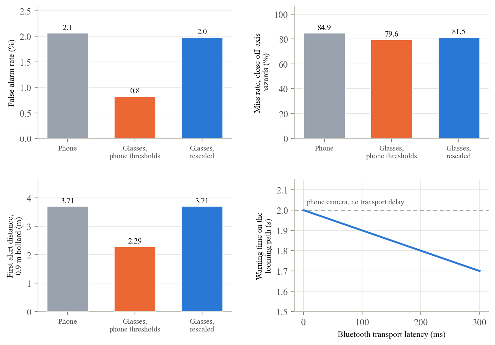
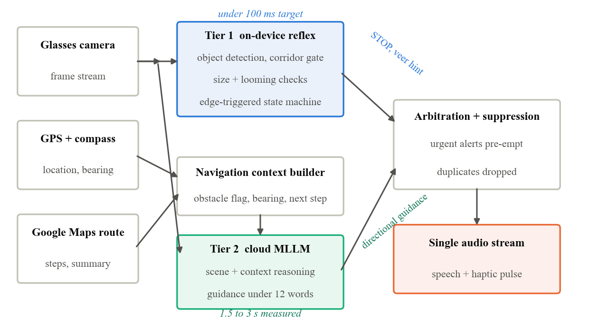
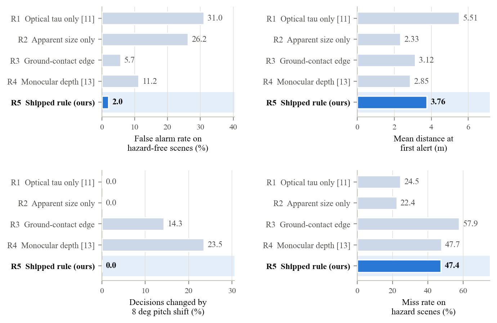
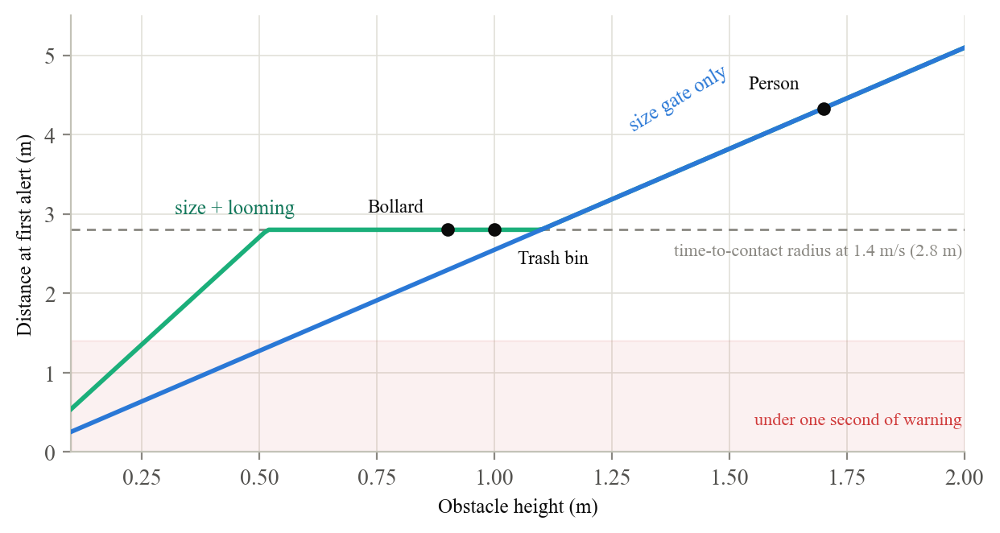
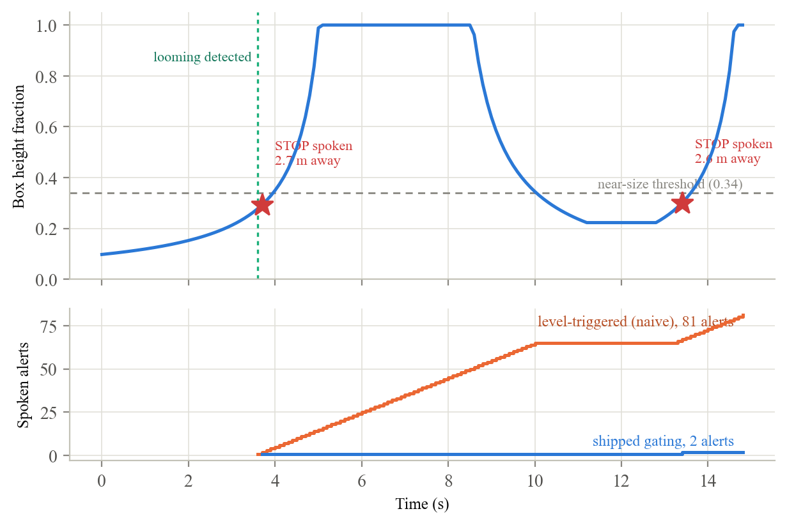

# VisionAI

> **You are on the `meta-glasses` branch.** This is work after the paper: the safety reflex now runs
> on the Ray-Ban Meta camera instead of the phone's. The paper's system as published is on
> [`main`](https://github.com/adhvayjagadeesh/GuideGlass). Setup, safety behavior, and known gaps are
> in [`docs/META_GLASSES.md`](docs/META_GLASSES.md).

## What this branch adds

| Addition | Where |
|---|---|
| Glasses camera mode, a fourth launcher button, streaming through Meta's Wearables Device Access Toolkit 1.0.0 | `app/.../glasses/GlassesCameraSource.kt` |
| Automatic switch to the phone camera if the glasses are taken off, disconnect, or overheat | `vision/VisionActivity.kt` |
| Reflex thresholds rescaled for the glasses lens | `vision/ReflexScaling.kt` |
| Simulation of the phone camera against the glasses camera | `paper/simulation/sim_glasses.py` |
| Unit tests, and device tests against Meta's simulated glasses | `app/src/test/`, `app/src/androidTest/` |
| Toolchain upgrade the toolkit requires: Kotlin 2.2, AGP 8.13, compileSdk 36, **minSdk 29** | `build.gradle.kts`, `app/build.gradle.kts` |

**What the simulation found.** Every reflex threshold is a fraction of the camera frame, and the
glasses lens is wider than the phone's, so objects look smaller.



- Plugging the glasses in with the phone's thresholds is a safety regression. The first warning for a
  0.9 m bollard drops from 3.71 m to 2.29 m.
- Rescaling the thresholds for the lens restores the phone's performance exactly, and the app does
  this automatically when the glasses stream starts.
- A wider lens does not by itself recover close hazards off to one side. The reflex's walking corridor
  is what excludes them, so that is the setting to revisit.
- Bluetooth delay is not yet measured. Each 100 ms of it costs 0.14 m of warning at walking pace.

**Status.** Tested against Meta's simulated glasses only, not real hardware. The glasses' field of view
is an estimate that still needs measuring.

---

Real-time navigation assistance for blind and low-vision (BLV) travelers, and a framework for
evaluating aids like it before they reach real streets.

This repository accompanies our paper, *VisionAI: Real-Time Multimodal Navigation Assistance for
Blind and Low-Vision People*. It holds the Android application the paper describes, a browser client
with the same behavior, and the simulation study behind every figure and number in the paper's
Results.

> **Research prototype.** VisionAI has not yet been evaluated with blind or low-vision participants,
> and it is not a mobility aid. Never use it in place of a cane, a guide dog, or orientation and
> mobility training.

## The idea

Today's AI scene-description tools answer questions about a photo the user chose to take. Walking
needs something different: a system that watches continuously, speaks up on its own, and gets the
timing right. A warning that arrives too late, an alarm about nothing, or the same alert repeated
dozens of times can each make an aid unusable, and benchmarks that score one answer to one question
do not directly represent any of them.

The paper makes three contributions.

1. **A two-tier architecture.** A cloud multimodal model takes 1.5 to 3 seconds to respond, and a
   walker covers 2 to 4 meters in that time. Urgent obstacle alerts therefore come from an on-device
   reflex with a 100 ms budget, while the cloud model supplies richer guidance off the critical path.
2. **An operational evaluation framework.** Seven metrics, each stated as a unit, a source of ground
   truth, and a measurement procedure, including temporal and proactive measures that static,
   user-initiated benchmarks do not directly capture.
3. **A simulation study** of the reflex's decision layer against four published alternative criteria
   on identical scenes, reporting its operating envelope, its sensitivity to tuning, and its blind spots.

## Architecture



| Tier | Runs on | Job | Built from |
|---|---|---|---|
| Reflex | the phone | Speak "stop" and pulse the phone for anything in the walking path, with a local veer hint | ML Kit object detection, a walking-corridor gate, size and looming cues, edge-triggered alerts |
| Guidance | the cloud | Short spoken directions that combine the scene with the route | Gemini, given the camera frame and a structured navigation context |
| Navigation | the phone | Routing, turn-by-turn steps, heading | Google Maps Places and Directions, GPS, compass |

An arbitration layer lets urgent alerts pre-empt everything else and drops duplicates, so the user
hears one stream. The reflex never waits on the network.

## Evaluation framework

| Metric | What it measures | Reach of existing benchmarks |
|---|---|---|
| Time to warning | Seconds or meters between the first alert and contact | Not directly represented |
| False alarm rate | Urgent alerts when nothing is in the walking path | Not directly represented |
| Inaccurate prediction rate | Hazards in the path that got no alert before contact | Partially covered |
| Repetition rate | Spoken alerts per continuous encounter with one obstacle | Not directly represented |
| Instruction correctness | Whether the spoken action matches a safe action for that moment | Partially covered |
| Hallucination rate | Utterances asserting something absent from the frame | Addressed by prior work |
| Trust and cognitive load | Ratings and interviews with BLV participants over repeated use | Partially covered |

The simulation measures the first five on our own reflex. Hallucination rate needs real model
outputs on real scenes and trust needs people, so both are deferred to participant trials.

## Results

Every number here comes from simulating the decision layer, not from people. The scene model,
sampling, and expected values are documented in [`paper/simulation/README.md`](paper/simulation/README.md).

**Against alternative decision rules.** Five rules on the same 16,000 hazard-free and 8,000 hazard
scenes. The shipped rule is R5, highlighted.



- **Fewest false alarms:** 2.0 percent, 2.9 times fewer than the best alternative.
- **Unaffected by camera tilt:** its decisions never change under an 8 degree pitch shift, where the
  two rules that reason about the ground change on 14 and 24 percent of scenes.
- **The trade we report rather than hide:** it misses more hazards than the two rules with no spatial
  gate. Those catch more because they alert on anything looming anywhere in the frame, and they raise
  13 to 15 times as many false alarms.

**Warning time.** A looming cue, triggered on estimated time to contact, lifts mid-sized and small
obstacles to a full two seconds of warning.



**Alert discipline.** Walking toward a bollard, stopping, backing off, and approaching again, the
reflex speaks exactly twice. A naive policy would speak 81 times on the same frames.



## What simulation cannot show

The study validates one system's decision layer against the framework. It does not validate the
framework itself.

- The system, the simulator, and the framework were built by the same authors, which is weaker
  evidence than an independent replication.
- Scenes are synthetic and detection is idealized, so results describe decision logic given a
  detection, not whether the detector fires under real lighting, motion blur, and hardware.
- Hallucination rate and trust are not measured at all.

## Reproduce the results

The simulation needs only Python 3 with NumPy and Matplotlib. Every random seed is fixed, and a clean
checkout regenerates all thirteen figures and three result files byte for byte, in under ten seconds.

```bash
pip install numpy matplotlib
cd paper/simulation
python3 sim_reflex.py && python3 sim_extra.py && python3 sim_baselines.py
```

The thresholds under test are the ones the app ships with. The simulation README records which
source file each comes from, and how to add a new decision rule to the comparison.

## Run the app

**Android.** Open the project in Android Studio. Copy `local.properties.example` to `local.properties`
(it is gitignored) and fill in `GEMINI_API_KEY`, `GOOGLE_MAPS_KEY`, and `GOOGLE_DIRECTIONS_KEY`. The
Maps key needs the Maps SDK for Android, Places API, and Directions API enabled. Then build and run.
On this branch the app needs Android 10 or later, and the build needs JDK 21 (Android Studio's
bundled JDK works; JDK 24 is too new).

The launcher offers vision mode, navigation, and both together. Reflex tuning lives in
`ObstacleDetector.ReflexTuning`, and the Gemini prompt in `ai/GeminiManager.kt`.

**Browser.** A port with the same tiers, thresholds, and prompt runs on a laptop webcam or a phone
browser. See [`web/README.md`](web/README.md).

## Repository map

| Path | Contents |
|---|---|
| `app/` | Android app in Kotlin. The reflex is in `vision/ObstacleDetector.kt`, the cloud tier in `ai/` |
| `web/` | Browser client with the same three tiers |
| `paper/simulation/` | Simulator, result files, and every figure in the paper |
| `docs/` | Project status and planning notes |
| `guideglass_technical_deep_dive.md` | Threading model and design history |

## Branches

| Branch | What it holds |
|---|---|
| `main` | The system and study as described in the paper |
| [`meta-glasses`](https://github.com/adhvayjagadeesh/GuideGlass/tree/meta-glasses) | Work after the paper: running the reflex on the Ray-Ban Meta camera through Meta's Wearables Device Access Toolkit, with a simulation of how the glasses lens changes the reflex |

## Next steps

The plan moves from simulation to people in stages, each of which has to earn the next. First,
structured street tests with sighted researchers. Next, trials with BLV volunteers on closed courses,
with ethics approval and an orientation and mobility specialist present. Last, everyday routes over
several weeks. In parallel, a small on-device model would cut the cloud tier's delay, and the camera
moves from the phone to glasses.
